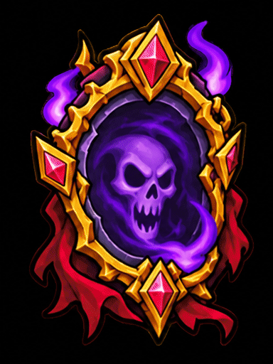

# Purple skull — magical idle loop

An initial animation based on the supplied purple skull emblem: drifting purple smoke and a pulsing skull glow, with the gold frame and red decorations held still. The eight key poses were generated from the reference, so this is a recreation rather than a pixel-exact edit of the original artwork.



- [Animated WebP](purple-skull.webp): lossless, looping, recommended for playback.
- [MP4](purple-skull.mp4): H.264 video for editing and sharing; enable looping in the player.
- [GIF](purple-skull.gif): looping preview with reduced color precision.
- [Sprite sheet](purple-skull-sheet.png) and [frame metadata](sprites.json): game-engine import.
- [Still poster](poster.png) and [eight generated key poses](keyframes.png).

The animation contains **60 frames at 30 fps**, for a **two-second loop** at **384 × 512 pixels** on a **black background**. The sprite sheet is **3840 × 3072 pixels**, with 10 columns and 6 rows, read left to right and top to bottom. WebP/GIF timing is rounded to whole milliseconds/centiseconds. Transparency is not included in this first version.

To regenerate, use ImageMagick 7 and FFmpeg with `minterpolate`, `libwebp_anim`, and `libx264`:

```bash
cd /workspace/what-ever
bash animations-purple-skull/generate.sh
```

The script overwrites only the generated files in this directory. It crops the eight key poses, holds non-purple regions static with a shared color mask, interpolates repeated cycles with optical flow, and exports the middle cycle for a continuous loop. Small interpolation artifacts may appear in the moving smoke.
